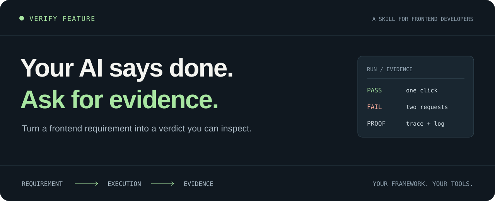

<p align="center">
  
</p>

<h1 align="center">Verify Feature</h1>
<p align="center"><strong>AI 说做完了，拿什么证明？</strong></p>
<p align="center">Midscene 跑交互，Bifrost 做 Mock，每个结论都有证据。</p>

<p align="center"><a href="README.md">English</a> · 简体中文<br><a href="#安装">安装</a> · <a href="#直接这样用">开始使用</a> · <a href="docs/example-report.md">报告示例</a></p>

---

## 构建通过之后，才轮到真正的问题

表单能打开，请求返回 200，页面弹出“保存成功”。

**但请求失败时，用户刚填的内容还在吗？重试会不会提交两次？刷新后数据还在吗？**

Verify Feature 是一个供 AI 编程助手使用的前端验证 skill。它把需求、用例、实际执行和证据连起来，让“完成”有可检查的依据。

```text
需求  →  用例  →  实际执行  →  检查证据  →  验证报告
                                          ├─ 通过
                                          ├─ 失败
                                          ├─ 阻塞
                                          └─ 未执行
```

## 安装

在你的前端项目根目录执行：

```sh
npx skills add baichen99/skills --skill verify-feature
```

按提示选择编程助手。这里使用第三方 [Skills CLI](https://github.com/vercel-labs/skills)，当前要求 Node.js 22.20+，默认只安装到当前项目。

也可以克隆或下载本仓库，将 **整个** `skills/development/verify-feature/` 文件夹复制到下列目录，保留其中的参考文档、脚本和模板，目标目录须为空：

| 编程助手 | 相对于项目根目录的目标路径 | 调用 |
| --- | --- | --- |
| Codex | `.agents/skills/verify-feature/` | `$verify-feature` |
| Claude Code | `.claude/skills/verify-feature/` | `/verify-feature` |
| Cursor | `.cursor/skills/verify-feature/` | `/verify-feature` |

安装目录依据 [Codex](https://learn.chatgpt.com/docs/build-skills)、[Claude Code](https://code.claude.com/docs/en/skills)、[Cursor](https://cursor.com/docs/skills) 官方文档。安装后没出现时，重新加载或重启助手。其他支持 [Agent Skills](https://agentskills.io/specification) 的工具可使用同一份目录；没有自动发现能力时，也可以让助手读取 [SKILL.md](SKILL.md) 及所引用的文件。

## 准备 Midscene 和 Bifrost

两者都包含在工作流中，工具本体单独安装：

| 工具 | 负责什么 | 没安装时 |
| --- | --- | --- |
| [Midscene](https://midscenejs.com/) | 浏览器交互、视觉与语义判断 | 提醒安装依赖并配置模型访问 |
| [Bifrost](https://github.com/bifrost-proxy/bifrost) | 接口 Mock、隔离代理规则、流量证据 | 提醒安装 CLI 和官方 agent skill |

详细步骤见[安装与就绪检查](references/setup.md)。skill 会先检测，不会静默安装或修改全局代理。缺什么就给出对应安装提示；依赖该工具的用例标记阻塞，其他独立检查可以继续。已有确定性测试仍可复用，如实记录实际工具。

## 直接这样用

调用 skill 后，把这类任务交给它：

**只验一个交互**

```text
验证 http://localhost:3000/settings 的个人资料表单。
保存失败时必须保留输入并提示错误；重试只提交一次，成功后页面更新。
复用项目已有测试和 Mock，交付结论与证据。
```

**只看一张图**

```text
按附件设计稿检查结算页，视口 390 × 844。
重点看间距、按钮可见性和横向溢出。
实际截图并查看，逐项说明差异。
```

**做一次完整需求验收**

```text
按 issue 中 AC-1 到 AC-6 验证购物车。
从真实应用入口执行，后端使用 Mock。
覆盖空状态、更新失败、重试和刷新。
所有必需用例都写进报告，阻塞和未执行的也要保留。
不要修改业务代码。
```

没有完整 Spec 也能用：给出明确预期就可以做单项检查。只有截图不需要建立整套用例系统；只要求配置 Mock，也不会自动扩大成 UI 验收。

## 拿到什么

按任务大小交付 Markdown 结果；完整验收包含：

| 内容 | 你能看清什么 |
| --- | --- |
| 需求 → 用例 → 测试映射 | 哪条验了，哪条遗漏了 |
| 预期与实际结果 | 为什么判断通过或失败 |
| 图片、录像、trace 或日志链接 | 别人能否复查这个结论 |
| 版本、入口、环境与后端模式 | 这个结论适用于哪一次运行 |
| 失败、阻塞、未执行项 | 还有哪些缺口 |
| 原始失败与重跑记录 | 重跑没有抹掉第一次的问题 |

下面是**虚构的格式示意，不是真实运行记录**：

| 需求 | 用例 | 结果 | 观察 |
| --- | --- | --- | --- |
| 保存失败保留输入 | VF-01 | 失败 | 返回 500 后，刚填写的姓名消失 |
| 重试只提交一次 | VF-02 | 通过 | 点击一次重试，捕获到一次请求 |
| 刷新后保留修改 | VF-03 | 阻塞 | 当前 Mock 没有持久状态 |

查看[带说明的报告示例](docs/example-report.md)、[报告模板](assets/report.md)和[用例模板](assets/case.md)。真实报告必须链接实际生成的证据，示例不会伪造截图或日志。

## 用你的技术栈，按你的项目跑

**React、Vue、Svelte、Angular、Web Components、原生页面，都可以按同一条验证链路组织。**

- 有 Playwright、Cypress 或 WebdriverIO，就复用现有 runner、fixture 和断言。
- 有 Testing Library、Storybook 或 TestBed，就沿用组件环境；视觉布局仍需浏览器验证。
- 有 MSW、请求拦截、Mock 服务或项目专用代理，就复用已有接口协议与重置方式。
- 新的过程验证使用 Midscene，新的代理与接口 Mock 使用 Bifrost；金额、ID、次数等仍配合精确断言。
- 真实应用入口、SSR、服务端请求、路由、Provider 和样式按项目实际边界处理。

不依赖特定内部平台，不要求迁移已有测试体系。Midscene、Bifrost 缺失时会提醒安装。以上是工作流的适配方向，**不表示已经逐框架、逐版本完成兼容性实测**。

## 几条让结论可信的约束

- **预期来自需求。** 不能拿当前实现的行为反过来定义“通过”。
- **截图生成和视觉判断分开。** 没有实际看图，就不能说样式符合。
- **流程结论需要实际走流程。** 一张最终截图不能证明失败重试或刷新持久化。
- **Mock 边界写清楚。** 前端加 Mock 通过，不代表真实后端已通过。
- **未执行就是未执行。** 缺浏览器、缺数据、工具报错，都有明确状态。
- **任务多大，流程多大。** 单项检查不强迫补完整 Spec、迁移工具或启动看板。

## 使用条件与边界

这是指令型 skill，包含参考文档、模板和一个可选的链接检查脚本。它本身不附带浏览器、测试 runner、模型服务或后端。编程助手需要能读取项目，并具有本次任务所需的执行和看图能力。

Midscene 需要配置模型访问，调用可能产生模型费用；Bifrost 需要 CLI 和官方 agent skill。配置由使用者自行提供，不随包附带凭证。可选的报告链接检查使用 Python 3.9+，没有第三方 Python 依赖：

```sh
python3 <skill目录>/scripts/check_report_links.py <报告.md>
```

脚本只检查支持的本地链接和 Markdown 锚点，不证明测试通过，也不验证外部链接；具体限制见[报告说明](references/reporting.md)。没有 Python 时可用文件工具检查。

**它能规范验证过程，无法保证模型每次遵守、发现所有缺陷或替你担保上线。** 保留正常的工程审查。公开截图、trace、HAR 和日志前检查隐私与凭证；验证授权本身不包含生产写入或部署。

## 一起改进

欢迎提交真实失败案例：明确预期、助手实际做了什么、使用的框架和 runner，以及脱敏后的最小复现。一个漏验问题，比一份更长的泛用清单更有帮助。

本地自检：

```sh
python3 -m unittest discover -s tests -v
python3 scripts/check_package.py
```

这些检查 helper 和包结构，不等于跨助手、跨框架验收。[评估场景](docs/evaluation.md)列出了仍需实际调用助手验证的行为。

采用 [MIT](LICENSE) 许可证。如果它抓住了一个 AI 曾说“已经完成”的问题，欢迎在 issue 分享脱敏案例。
